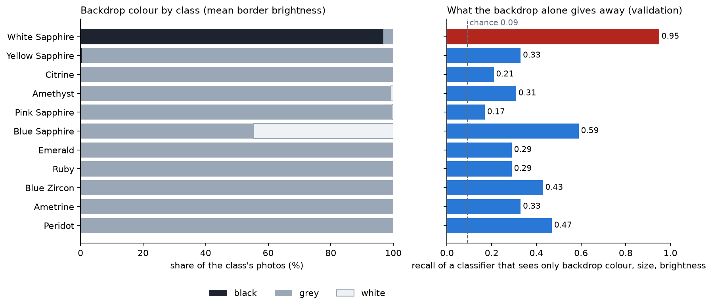

# Why White Sapphire is excluded from the benchmark

Backdrop = mean colour of the border pixels of each 1920x1200 photo. Black means mean brightness below 40/255, white above 230/255, grey in between. Computed on the kept photos of every class (`dataset/_cache/qc.csv`).

| class           |   images |   backdrop_median |   black_pct |   white_pct |   grey_pct |   backdrop_only_recall_11 |   backdrop_only_recall_10 |
|:----------------|---------:|------------------:|------------:|------------:|-----------:|--------------------------:|--------------------------:|
| Peridot         |      502 |             133.7 |         0   |         0   |      100   |                      0.47 |                      0.48 |
| Ametrine        |      501 |             133.7 |         0   |         0   |      100   |                      0.33 |                      0.35 |
| Blue Zircon     |      502 |             133.7 |         0   |         0   |      100   |                      0.43 |                      0.44 |
| White Sapphire  |      502 |               0   |        96.8 |         0   |        3.2 |                      0.95 |                    nan    |
| Yellow Sapphire |      502 |             144.3 |         0.4 |         0   |       99.6 |                      0.33 |                      0.33 |
| Ruby            |      521 |             151.3 |         0   |         0.2 |       99.8 |                      0.29 |                      0.32 |
| Emerald         |      501 |             152.3 |         0   |         0   |      100   |                      0.29 |                      0.29 |
| Blue Sapphire   |      499 |             203.5 |         0   |        44.7 |       55.3 |                      0.59 |                      0.6  |
| Pink Sapphire   |      497 |             133.7 |         0   |         0.4 |       99.6 |                      0.17 |                      0.19 |
| Amethyst        |      497 |             151.4 |         0   |         0.8 |       99.2 |                      0.31 |                      0.32 |
| Citrine         |      502 |             151.4 |         0   |         0   |      100   |                      0.21 |                      0.23 |

## Backdrop-only classifier

A random forest (300 trees, seed 42) trained on the training split and scored on the validation split, using only backdrop colour, image size and brightness. It sees no stone pixels.

|            |   accuracy |   macro_f1 |   chance |
|:-----------|-----------:|-----------:|---------:|
| 11 classes |      0.396 |      0.397 |    0.091 |
| 10 classes |      0.354 |      0.353 |    0.1   |

`White Sapphire` is on a black backdrop in 96.8% of its photos and is recovered with recall 0.95 from the backdrop alone. Every other class is almost entirely on grey; Blue Sapphire is on white in 44.7% of its photos. Removing White Sapphire lowers the backdrop-only accuracy from 0.396 to 0.354 (chance 0.091 and 0.100); what remains is mostly Blue Sapphire's white backdrop, which is what the background-dependence experiment measures.

The exclusion is one config switch (`benchmark.exclude_classes`); re-adding the class needs a cache rebuild and retraining.

